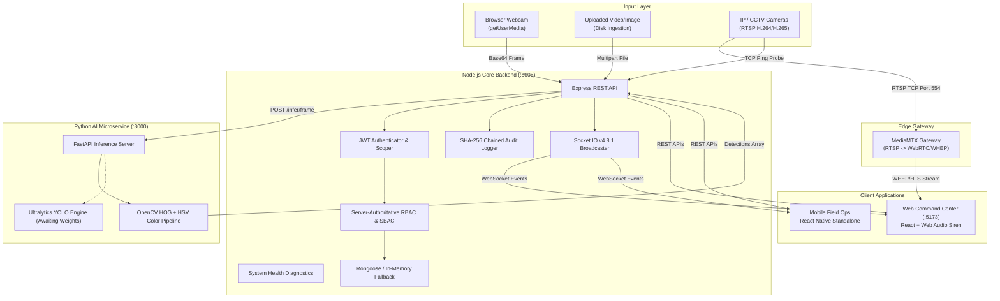
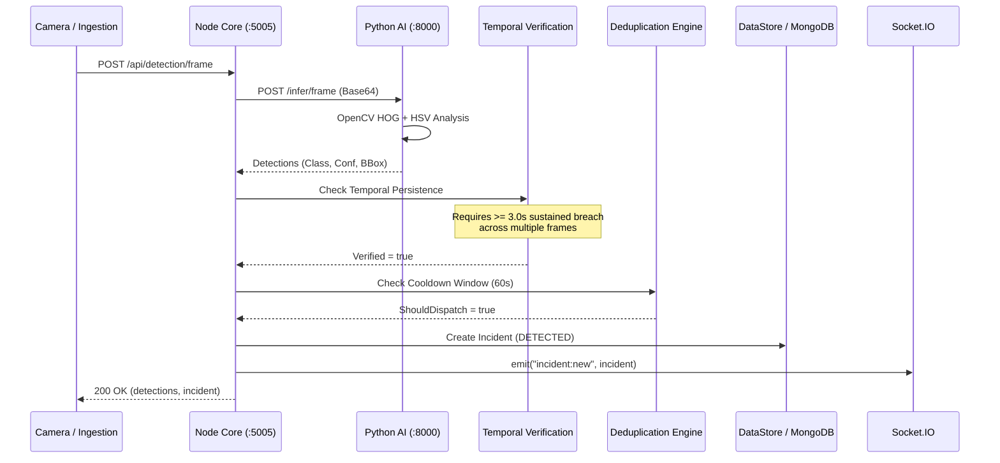

# SafeVision AI — Enterprise Architecture Specification

> **"See the Risk. Prevent the Incident. Protect the Workforce."**

SafeVision AI is designed as a distributed, high-concurrency industrial safety monitoring platform combining computer vision inference, authoritative access boundaries, cryptographic audit logs, and real-time incident event dissemination.

---

## 1. High-Level System Architecture

---

## 2. Security & Access Control Model

SafeVision AI enforces a 2-tier security model:

### A. Role-Based Access Control (RBAC)
Role determination is strictly server-authoritative. The backend validates the user's password, queries the user model, extracts permissions, and signs them into a cryptographically sealed JWT. The frontend cannot escalate or self-assign permissions.

1. **`ADMIN`**:
   - Capabilities: Manage users, shifts, safety rules, camera registrations; access cryptographic audit logs; system diagnostics.
2. **`PLANT_MANAGER`**:
   - Capabilities: Plant-wide incident monitoring, compliance reporting, workforce overview, camera surveillance review.
3. **`SAFETY_OFFICER`**:
   - Capabilities: Live camera surveillance, incident acknowledgment, steward dispatch, incident resolution, false-positive labeling.
4. **`SUPERVISOR`**:
   - Capabilities: Scoped to designated operational zones; acknowledge incidents; inspect team compliance. Explicitly **forbidden** from resolving incidents.
5. **`EMPLOYEE`**:
   - Capabilities: Personal safety metrics, hazard reporting, self-profile update. Explicitly **forbidden** from viewing raw CCTV feeds or foreign worker incident records.

### B. Scope-Based Access Control (SBAC)
All resource queries (incidents, cameras, workers) enforce site and zone scoping:
- `ADMIN` & `PLANT_MANAGER`: Scoped to `*` or plant sites.
- `SUPERVISOR`: Scoped strictly to `user.zoneIds` (e.g. `Zone 1 - Furnace Primary`, `Zone 2 - Secondary Refining`).
- `EMPLOYEE`: Scoped to `user.workerId`. Raw visual evidence snapshots are masked to protect worker privacy.

---

## 3. Cryptographic SHA-256 Audit Integrity

Audit logging adheres to a blockchain-style immutable hash chain:
1. **Genesis**: The initial audit record binds to a fixed 64-character zero hash:
   $$\text{GenesisHash} = \texttt{0000000000000000000000000000000000000000000000000000000000000000}$$
2. **Payload Serialization**:
   $$\text{Payload}_k = \text{JSON}(\text{id}, \text{timestamp}, \text{userId}, \text{action}, \text{resourceType}, \text{resourceId}, \text{previousHash}, \text{beforeSnapshot}, \text{afterSnapshot})$$
3. **Current Hash**:
   $$\text{CurrentHash}_k = \text{SHA-256}(\text{Payload}_k)$$
4. **Linkage**:
   $$\text{PreviousHash}_{k+1} = \text{CurrentHash}_k$$
5. **Verification**:
   `GET /api/admin/audit-logs/verify` reconstructs and checks every single link in the chain chronologically. If any record is modified in memory or database, verification fails with exact log ID and tamper reason.

---

## 4. Optical Inference & Verification Pipeline

To eliminate false alarms and ticket flooding in industrial environments, detections undergo multi-stage temporal verification:

---

## 5. Acoustic Siren Architecture

To adhere to browser autoplay policies:
- The siren utilizes the **HTML5 Web Audio API** (`AudioContext`, `OscillatorNode`, `GainNode`).
- Does not rely on static audio files that can fail to fetch or loop unpredictably.
- Synthesizes an authentic dual-tone emergency acoustic horn (800 Hz / 1000 Hz square wave modulation).
- Requires explicit operator arming via the navbar toggle (`safetyAudio.arm()`).
- High-severity and critical incidents automatically trigger siren playback when armed.
